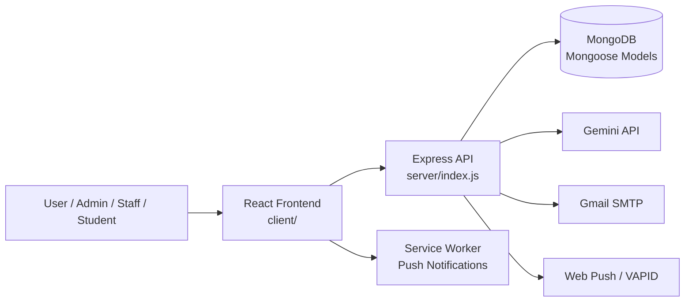
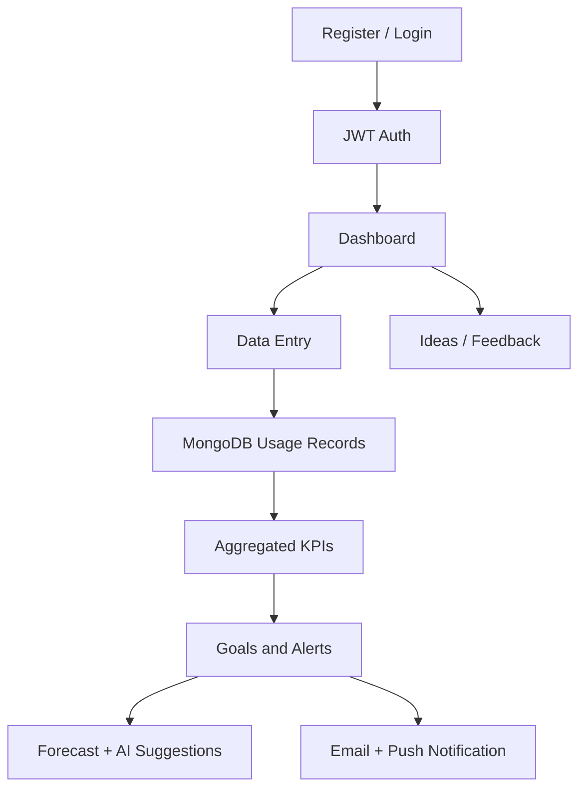
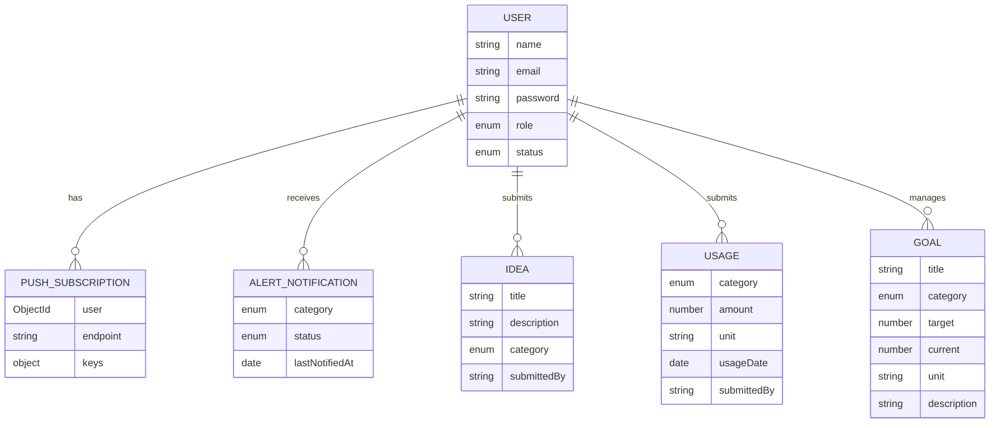

# EcoMetric — Sustainability Outcome Measurement System

EcoMetric is a full-stack MERN application for tracking and managing a campus or institutional sustainability program. It brings together resource usage data, performance goals, forecasting, and stakeholder engagement in one dashboard so administrators, staff, and students can monitor water, electricity, and waste consumption over time.

This repository contains a split-stack project:

- `client/` — React front end
- `server/` — Express + MongoDB back end

## 1. Project Overview

### Problem statement

Many institutions track sustainability initiatives in fragmented ways: spreadsheets, informal updates, and ad hoc meetings. Without a single system, it is difficult to:

- compare actual utility data with annual sustainability targets,
- spot resource spikes early,
- communicate risk to decision-makers,
- collect ideas and feedback from staff and students, and
- act on trend data before a target is missed.

### Purpose

EcoMetric provides a unified platform to record resource usage, compare current performance against institutional goals, forecast risk, and surface actionable recommendations. The goal is to make sustainability outcomes more visible, measurable, and responsive.

### Target users

- Campus administrators and sustainability leads
- Operational staff responsible for utilities and facilities
- Students or staff who contribute ideas and feedback
- Approved institutional users who need access to dashboards and alerts

### Key benefits

- Real-time visibility into environmental metrics
- Role-based access for different stakeholders
- Data-driven goal management and progress tracking
- AI-assisted forecasting and recommendations
- Proactive email and browser push alerts when categories trend over target
- Better campus engagement through idea submissions and feedback collection

### Real-world use cases

- A university tracks monthly water and electricity usage across departments.
- A facilities team sets annual waste-reduction goals and monitors progress.
- A sustainability office receives alerts before a category exceeds its target.
- Students submit improvement suggestions that become visible in a shared ideas board.

## 2. Current status

This project is an MVP / internal operational dashboard focused on sustainability resource tracking. The repository clearly implements the core workflows listed below.

### Completed features

- User registration and login
- Role-based access for `admin`, `staff`, and `student`
- Admin approval flow for new users
- Resource data entry for water, electricity, and waste
- Dashboard summaries and monthly category views
- Annual sustainability goals with progress tracking
- Forecasting and trend analysis for resource categories
- AI-powered suggestions using the Gemini API
- Email and push notification alerting
- Daily scheduled digest alerts
- Idea and feedback submission pages
- PDF report generation for sustainability summaries

### Planned or partial features

- No formal CI/CD workflow or deployment manifest was found in the repository.
- No Docker or containerized setup was found.
- There is no dedicated migration framework; MongoDB schema changes are handled through Mongoose models and live database updates.
- The repository currently contains a default Create React App smoke test that is not tailored to the project; there is no broad project-specific automated test suite.

## 3. Key Features

### 3.1 Multi-role access and approval workflow

The app enforces a role model:

- `admin` — can manage users, goals, alerts, and full system access
- `staff` — can enter usage data, configure goals, and review insights
- `student` — can view dashboards, insights, and submit ideas/feedback

New accounts are created in a `pending` state and require admin approval before becoming active.

### 3.2 Resource tracking dashboard

The dashboard summarizes utility data for:

- water
- electricity
- waste

It calculates totals, monthly breakdowns, goal progress, and carbon-equivalent style comparisons based on category metrics.

### 3.3 Goal management

Admins and staff can define annual targets by category. The dashboard compares current usage against the target and shows progress percentages. The goal form also suggests an AI-based target using a projected trend and annualized usage.

### 3.4 Forecasting and insight generation

The backend includes a linear regression-based forecasting model to estimate the next month and the next several months of usage. The app then marks whether usage is likely to cross the monthly target threshold.

### 3.5 AI-generated suggestions

The `server/utils/aiSuggestions.js` module calls the Google Gemini API when configured. It provides short, category-specific actions to reduce usage based on the trend and goal.

### 3.6 Alerts, email, and push notification support

When a category exceeds its target or is projected to cross soon, the system:

- checks the latest alert status,
- sends an email to admin/staff recipients,
- sends a browser push notification to subscribed devices,
- writes an alert record to avoid spam,
- and can send a daily summary digest using a cron job.

### 3.7 Ideas and feedback board

Users can submit:

- ideas
- feedback

This creates a simple engagement layer that surfaces suggestions for campus sustainability improvements.

### 3.8 PDF reporting

The client includes PDF export functionality for reports built from usage summary, goals, monthly breakdowns, and AI forecast results.

## 4. Screenshots and Demo

No screenshots, GIFs, or demo videos are currently included in this repository.

Use the following placeholder structure if you want to add them later:

```text
./docs/
  screenshots/
    dashboard.png
    goals.png
    insights.png
    ideas.png
```

Then reference them in the README with relative links such as:

```md

```

If a live demo exists, replace the placeholder with the actual URL and keep it verified.

## 5. Technology Stack

### Frontend

- React 19
- Create React App (`react-scripts`)
- React Router DOM
- MUI (Material UI)
- Bootstrap
- Chart.js + react-chartjs-2
- Recharts
- jsPDF + jsPDF AutoTable
- Axios for API calls

### Backend

- Node.js
- Express
- Mongoose
- JWT for authentication
- Helmet for HTTP header hardening
- CORS
- Express Rate Limit
- node-cron for scheduled notifications
- nodemailer for SMTP email alerts
- web-push for browser notifications

### Database

- MongoDB via Mongoose

### AI and external services

- Google Gemini API (`GEMINI_API_KEY`)
- Gmail SMTP for email sending
- VAPID keys for browser push notifications

### Development tools

- npm
- nodemon
- dotenv
- ESLint / CRA defaults (basic setup only)

## 6. System Architecture

EcoMetric is a split application: the React front end runs separately from the Node/Express API, with MongoDB as the persistent storage layer.



### Major system modules

- `client/src/pages` — screens such as login, dashboard, goals, insights, ideas, users
- `client/src/context/AuthContext.js` — current authenticated user state
- `client/src/components` — navbar, notifications, route guards
- `server/routes` — API endpoints grouped by resource
- `server/models/model.js` — MongoDB schema definitions
- `server/utils` — forecasting, alerting, AI suggestions, email, push notification, scheduler logic
- `server/middleware` — auth and error handling

## 7. Project Folder Structure

```text
.
├── .gitignore
├── client/
│   ├── package-lock.json
│   ├── package.json
│   ├── public/
│   │   ├── favicon.ico
│   │   ├── index.html
│   │   ├── logo192.png
│   │   ├── logo512.png
│   │   ├── manifest.json
│   │   ├── robots.txt
│   │   └── sw.js
│   └── src/
│       ├── App.css
│       ├── App.js
│       ├── App.test.js
│       ├── components/
│       │   ├── Navbar.js
│       │   ├── NotificationBell.js
│       │   └── ProtectedRoutes.js
│       ├── context/
│       │   └── AuthContext.js
│       ├── index.css
│       ├── index.js
│       ├── pages/
│       │   ├── Dashboard.js
│       │   ├── Dataentry.js
│       │   ├── Goals.js
│       │   ├── Ideas.js
│       │   ├── Insights.js
│       │   ├── Login.js
│       │   ├── Register.js
│       │   └── User.js
│       ├── services/
│       │   └── api.js
│       ├── theme.js
│       ├── utils/
│       │   ├── generateReport.js
│       │   ├── pushNotifications.js
│       │   └── sendNotificationEmail.js
│       └── ...
├── server/
│   ├── .env.example
│   ├── config/
│   │   └── db.js
│   ├── middleware/
│   │   ├── authMiddleware.js
│   │   └── errorMiddleware.js
│   ├── models/
│   │   └── model.js
│   ├── package-lock.json
│   ├── package.json
│   ├── routes/
│   │   ├── auth.js
│   │   ├── goal.js
│   │   ├── idea.js
│   │   ├── insights.js
│   │   ├── notifications.js
│   │   ├── resource.js
│   │   └── user.js
│   ├── utils/
│   │   ├── aiSuggestions.js
│   │   ├── alertCheck.js
│   │   ├── emailer.js
│   │   ├── forecast.js
│   │   ├── notify.js
│   │   ├── scheduler.js
│   │   ├── usageStats.js
│   │   └── webPush.js
│   └── index.js
└── README.md
```

### Notable files

- `server/index.js` — application entry point and route registration
- `server/models/model.js` — database schema definitions
- `server/middleware/authMiddleware.js` — JWT validation and role checks
- `server/routes/insights.js` — forecasting and suggestions
- `server/routes/notifications.js` — push subscription management and digest endpoints
- `client/src/pages/Dashboard.js` — main KPI and chart view
- `client/src/pages/Insights.js` — forecast cards and AI suggestion UI
- `client/src/utils/generateReport.js` — PDF report generation

## 8. Prerequisites

The project was built as a local development app using Node.js and MongoDB.

Recommended requirements:

- Node.js 20.19.0 or newer (required by the current Mongoose version)
- npm
- MongoDB instance (local or Atlas)
- Internet access for Gemini API and Gmail SMTP if you enable those features
- Modern browser with notification permission support for push alerts

### Optional external services

- A free or paid Google Gemini API key
- Gmail account with app password support for SMTP email alerts
- VAPID key pair for push notifications

## 9. Installation and Setup

### 1) Clone the repository

```bash
git clone https://github.com/Arul-sankaran/Smart-Sustaniability-Management-System.git
cd Smart-Sustaniability-Management-System
```

### 2) Install server dependencies

```bash
cd server
npm install
```

### 3) Install client dependencies

```bash
cd ../client
npm install
```

### 4) Configure environment variables

Copy `server/.env.example` to `server/.env`, then set the required values. Never commit your `.env` file or real credentials.

### 5) Configure MongoDB

Use a valid MongoDB connection string in `DB`. For MongoDB Atlas, use a connection string like:

```env
DB=mongodb+srv://<username>:<password>@<cluster-host>/Outcome_measurement
```

### 6) Start the server

```bash
cd server
npm run dev
```

The API should start on `http://localhost:4000`.

### 7) Start the client

```bash
cd client
npm start
```

The app should open in the browser on `http://localhost:3000`.

### 8) Verify that the application is running

- Frontend loads without errors
- Login or registration page is available
- Backend responds at `http://localhost:4000/api/...`
- MongoDB connection is successful in the server logs

## 10. Environment Variables

Copy `server/.env.example` to `server/.env` and replace placeholders with your own values. Never commit real credentials.

| Variable | Description | Required | Example |
|---|---|---:|---|
| `DB` | MongoDB connection string | Yes | `mongodb://127.0.0.1:27017/Outcome_measurement` |
| `JWT_SECRET` | Secret used to sign auth tokens | Yes | `replace_with_a_long_random_secret` |
| `PORT` | API port | No | `4000` |
| `NODE_ENV` | Runtime environment name | No | `development` |
| `GEMINI_API_KEY` | API key for Gemini AI suggestions | No (feature optional) | `your_gemini_api_key` |
| `VAPID_PUBLIC_KEY` | Public key for web push notifications | No (feature optional) | `your_vapid_public_key` |
| `VAPID_PRIVATE_KEY` | Private key for browser push notifications | No (feature optional) | `your_vapid_private_key` |
| `VAPID_SUBJECT` | Contact or mailto value for VAPID | No | `mailto:admin@example.com` |
| `EMAIL_USER` | Gmail account for alert emails | No (feature optional) | `your_email@gmail.com` |
| `EMAIL_PASS` | Gmail app password | No (feature optional) | `your_gmail_app_password` |
| `DIGEST_CRON` | Cron schedule for the daily alert digest | No | `0 8 * * *` |

Important notes:

- `server/.env.example` contains placeholders only; replace them with your own values.
- The client uses `REACT_APP_API_URL` for the backend API base URL. It defaults to the existing Render API at `https://sustainability-outcome-measurement-system.onrender.com/api`.
- For local development, set `REACT_APP_API_URL=http://localhost:4000/api` in `client/.env.local`. For a different deployment, set it to that backend's `/api` URL in the frontend hosting provider's environment settings and rebuild the client.

## 11. Running the Application

### Development mode

Start the API:

```bash
cd server
npm run dev
```

Start the frontend:

```bash
cd client
npm start
```

Open the app at:

```text
http://localhost:3000
```

### Production build

```bash
cd client
npm run build
```

This produces a production bundle in `client/build/`.

You can then serve the build using a static host or deploy it behind a backend/proxy setup. No explicit production server script is defined in the project.

## 12. Available Scripts and Commands

### Client (`client/package.json`)

| Command | Purpose |
|---|---|
| `npm start` | Runs the React development server |
| `npm run build` | Produces the production build |
| `npm test` | Runs the React test runner |
| `npm run eject` | Ejects CRA config (not usually needed) |

### Server (`server/package.json`)

| Command | Purpose |
|---|---|
| `npm start` | Starts the Express server |
| `npm run dev` | Starts the server with `nodemon` for hot reload |

### Notes

- There is no compiled server build step in the repository.
- There are no lint, format, migration, or seed scripts defined in the current project setup.

## 13. Application Workflow

### End-to-end flow

1. A user creates an account on the frontend.
2. The request is posted to `POST /api/auth/register`.
3. The account is stored as `pending` until an admin approves it.
4. The user logs in through `POST /api/auth/login`.
5. The backend returns a JWT that is attached to subsequent API requests.
6. Staff/admin users enter usage data through the Data Entry page.
7. Usage records are stored in the `Usage` collection with category, amount, unit, and date.
8. The dashboard calls `GET /api/usage/dashboard` and aggregates recorded totals.
9. Goals are compared with current usage and progress bars update.
10. Forecasts are generated from a running history of usage totals.
11. The insights page calls `/api/insights/forecast` and `/api/insights/suggestions`.
12. If a category is over target or predicted to cross soon, alert logic sends email and push notifications.
13. Users can also submit ideas and feedback to the shared ideas board.



### Data processing and validation

- Request payloads are validated in route handlers for required fields.
- JWT verification and role checks are enforced in `authMiddleware.js`.
- Resource routes enforce category and amount validation.
- Goal creation and usage inserts rely on required fields like `category`, `amount`, `unit`, and `usageDate`.

## 14. Database Documentation

### Database technology

The application uses MongoDB with Mongoose.

### Important collections and models

The schema definitions are all in `server/models/model.js`.

#### User

Fields:

- `name` — required
- `email` — required, unique
- `password` — required, hashed with bcrypt
- `role` — `admin`, `staff`, or `student`
- `status` — `pending`, `approved`, or `rejected`
- timestamps

#### Goal

Fields:

- `title` — required
- `category` — `water`, `electricity`, or `waste`
- `target` — required numeric target
- `current` — default 0
- `unit` — required
- `duration` — optional
- `description` — optional, used for year filtering in some logic
- timestamps

#### Usage

Fields:

- `category` — `water`, `electricity`, or `waste`
- `amount` — required numeric usage
- `unit` — required
- `usageDate` — required date
- `submittedBy` — optional submitter name
- timestamps

#### Idea

Fields:

- `title` — required
- `description` — required
- `submittedBy` — user name
- `category` — `idea` or `feedback`
- timestamps

#### PushSubscription

Fields:

- `user` — reference to `User`
- `endpoint` — required, unique subscription endpoint
- `keys.p256dh` — required
- `keys.auth` — required
- timestamps

#### AlertNotification

Fields:

- `category` — required, unique per category
- `status` — `already_over` or `projected`
- `lastNotifiedAt` — required date
- timestamps

### Relationships

- `User` has a one-to-many relationship with `PushSubscription` via `user` reference.
- `Usage`, `Goal`, and `Idea` are independent document collections and are not strongly linked to a user model by foreign key relations in this implementation.
- `submittedBy` is a string rather than a full object reference in several collections.

### ER diagram



### Migration and seed notes

- No migration folder or migration scripts were found in this repository.
- No seed data script was identified.
- Data is expected to be created through the API or manually inserted within the MongoDB instance.

## 15. API Documentation

The application exposes a set of authenticated API endpoints under `/api`.

### Authentication

Some endpoints require a Bearer token in the `Authorization` header:

```http
Authorization: Bearer <JWT_TOKEN>
```

### Core endpoint summary

| Method | Path | Purpose | Auth |
|---|---|---|---|
| `POST` | `/api/auth/register` | Register a user | Public |
| `POST` | `/api/auth/login` | Log in and receive JWT | Public |
| `GET` | `/api/users` | List users | Admin |
| `POST` | `/api/users` | Create a user (admin) | Admin |
| `PUT` | `/api/users/approve/:id` | Approve a user | Admin |
| `PUT` | `/api/users/reject/:id` | Reject a user | Admin |
| `GET` | `/api/usage/all` | List all usage records | Admin / Staff |
| `POST` | `/api/usage` | Add usage record | Admin / Staff |
| `GET` | `/api/usage/dashboard` | Get summary and monthly usage data | Authenticated |
| `PUT` | `/api/usage/:id` | Update a usage record | Admin / Staff |
| `DELETE` | `/api/usage/:id` | Delete a usage record | Admin / Staff |
| `GET` | `/api/goals` | Fetch goals and current usage details | Authenticated |
| `POST` | `/api/goals` | Create a goal | Admin / Staff |
| `PUT` | `/api/goals/:id` | Update a goal | Admin |
| `DELETE` | `/api/goals/:id` | Delete a goal | Admin |
| `GET` | `/api/ideas` | List ideas and feedback | Authenticated |
| `POST` | `/api/ideas` | Submit an idea or feedback item | Authenticated |
| `DELETE` | `/api/ideas/:id` | Delete an idea | Admin |
| `GET` | `/api/insights/forecast` | Forecast resource trend | Authenticated |
| `GET` | `/api/insights/alerts` | Active alerts | Admin |
| `POST` | `/api/insights/suggestions` | AI suggestions for category | Authenticated |
| `GET` | `/api/notifications/vapid-public-key` | Get push public key | Authenticated |
| `POST` | `/api/notifications/subscribe` | Register browser push subscription | Admin / Staff |
| `POST` | `/api/notifications/unsubscribe` | Remove subscription | Authenticated |
| `POST` | `/api/notifications/test-digest` | Manually trigger alert digest | Admin |

### Authentication examples

#### Register

```http
POST /api/auth/register
Content-Type: application/json

{
  "name": "Jane Smith",
  "email": "jane@campus.edu",
  "password": "Password123"
}
```

Successful response:

```json
{
  "message": "Registration successful. Awaiting admin approval."
}
```

#### Login

```http
POST /api/auth/login
Content-Type: application/json

{
  "email": "jane@campus.edu",
  "password": "Password123"
}
```

Successful response:

```json
{
  "_id": "64b7...",
  "name": "Jane Smith",
  "email": "jane@campus.edu",
  "role": "staff",
  "token": "<JWT_TOKEN>"
}
```

### Usage submission example

```http
POST /api/usage
Authorization: Bearer <JWT_TOKEN>
Content-Type: application/json

{
  "category": "water",
  "amount": 1450,
  "unit": "L",
  "usageDate": "2026-10-15",
  "submittedBy": "Jane Smith"
}
```

Successful response:

```json
{
  "_id": "...",
  "category": "water",
  "amount": 1450,
  "unit": "L",
  "usageDate": "2026-10-15T00:00:00.000Z",
  "submittedBy": "Jane Smith"
}
```

### Forecast example

```http
GET /api/insights/forecast?category=water&periods=3
Authorization: Bearer <JWT_TOKEN>
```

Typical response shape:

```json
{
  "category": "water",
  "forecastNextMonth": 1500,
  "trend": "increasing",
  "confidence": "medium",
  "goal": {
    "target": 20000,
    "unit": "L",
    "monthlyThreshold": 1666.67
  },
  "willCrossThreshold": true
}
```

### Error responses

Common HTTP error responses include:

- `400 Bad Request` — required payload missing or invalid
- `401 Unauthorized` — token missing or invalid
- `403 Forbidden` — role does not have permission
- `404 Not Found` — resource missing
- `500 Internal Server Error` — unexpected backend failure

## 16. Authentication and Authorization

### Login and registration workflow

- Users register with name, email, and password.
- The app checks if the email already exists.
- If the user is a rejected account, re-registration is allowed and the account is reset to `pending`.
- When a user logs in, the server verifies the password with `bcrypt.compare()` and ensures the account is not in `pending` or `rejected` state.
- Successful login returns a JWT signed with `JWT_SECRET`.

### Authentication mechanism

- JWT-based stateless authentication
- Tokens are validated in `server/middleware/authMiddleware.js`
- The `protect` middleware sets `req.user` and rejects requests with invalid or missing tokens

### Authorization model

- `admin` — full access to users, goals, alerts, and admin-only utilities
- `staff` — access to usage entry, goals, and dashboard/insights
- `student` — dashboard access, insights, and idea submission

### Security considerations

- Password hashing uses `bcryptjs`
- Routes are protected with JWT checks
- Rate limiting is enabled globally via `express-rate-limit`
- Helmet is used to add HTTP header protections
- Approved status must be active for non-admin users

## 17. User Guide

### Register an account

1. Open the app and navigate to `/register`.
2. Enter your name, email, and password.
3. Submit the form.
4. Your account remains in `pending` status until an admin approves it.

### Log in

1. Go to `/login`.
2. Enter your email and password.
3. When approved, you are redirected to the dashboard.

### Dashboard

- View total resource usage by category
- Monitor monthly trends
- Review goal progress
- Download a PDF report if needed

### Data Entry

- Add water, electricity, or waste usage records
- Include quantity, unit, and date
- Edit or delete records from the list

### Goals

- Define annual reduction goals
- Link them to a category and optional year
- See progress bars and AI-informed recommended target values

### Ideas and Feedback

- Submit practical suggestions or campus feedback
- View items submitted by other users in grouped sections
- Admins can delete inappropriate or duplicate entries

### Insights

- View trend forecasts by category
- Check whether a category is likely to exceed a target
- Generate AI suggestions for corrective action

### Alerts and notifications

- Admins can see active alert notices in the notification popover
- Staff/admin users can enable push notifications for their device
- The schedule sends a daily digest email and push message if alerts are active

## 18. Testing

### What exists in the repository

The repo currently contains:

- a default CRA smoke test: `client/src/App.test.js`
- no clear server-side test suite
- no end-to-end test suite
- no dedicated CI configuration or automated test workflow in the repository contents inspected

### How to run the frontend tests

```bash
cd client
npm test -- --watchAll=false
```

### Current testing limitations

The current test coverage is not project-specific and does not validate the business-critical flow of the sustainability system. The repository would benefit from:

- backend route tests,
- auth tests,
- usage validation tests,
- alert generation tests,
- AI fallback tests,
- and end-to-end coverage for the dashboard workflows.

## 19. Code Quality and Development Guidelines

The project already follows a typical full-stack Node/React structure. To keep the code base maintainable:

- Keep server-only logic in `server/` and front-end UI in `client/src/`
- Use existing naming conventions: camelCase variables and functions, descriptive route names, and Mongoose model definitions in one place
- Keep authentication and validation middleware centralized
- Avoid committing secrets to source control
- Keep feature updates aligned with the existing page structure and route organization
- Add tests for new business logic, especially forecasting and notification logic
- Ensure all new env variables are documented in this README

## 20. Security

### Current security practices

- Password hashing with `bcryptjs`
- JWT-based auth
- Role-based route protection
- Helmet headers
- Express rate limiting
- Notification subscriptions validated before storing

### Security gaps / known considerations

The repository is not a production-grade hardened system by default. Some items to review before deployment:

- No dedicated secrets manager was identified
- No explicit CSRF protection layer was implemented
- No automated dependency or vulnerability scanning file was found
- No container hardening or reverse-proxy security configuration was included in the repo
- The frontend requires a reachable API base URL; configure `REACT_APP_API_URL` for each deployment environment when the default Render API is not the intended backend.

### Recommended production checklist

- Use a strong `JWT_SECRET`
- Keep `DB` credentials in a managed environment system, not in committed source files
- Use environment-specific secrets for each environment
- Restrict database access to approved hosts
- Rotate Gmail app passwords and VAPID keys periodically
- Validate all API inputs at the route layer and additional client-side validation when appropriate
- Add automated security scanning and test coverage before broad production deployment

## 21. Development Notes and Known Limitations

- The project is organized as a multi-package app rather than a single monorepo package.
- The front-end API base URL is configurable with `REACT_APP_API_URL`; it defaults to the existing Render API URL.
- Some logic is intentionally implemented as server-side checks for resource alerts and scheduled digests.
- The app is useful as a sustainability operations dashboard but it is not a full enterprise-grade ESG platform out of the box.

## 22. Summary

EcoMetric is a practical sustainability reporting and alerting application that fits the operational needs of a campus or institutional environment. Its core strengths are:

- measurable resource tracking,
- role-based user management,
- annual goal tracking,
- predictive insights,
- automated alerts,
- and stakeholder engagement through ideas and feedback.

It is a strong MVP for a sustainability management system and provides a clear foundation for expansion into broader environmental governance, analytics, and reporting workflows.
